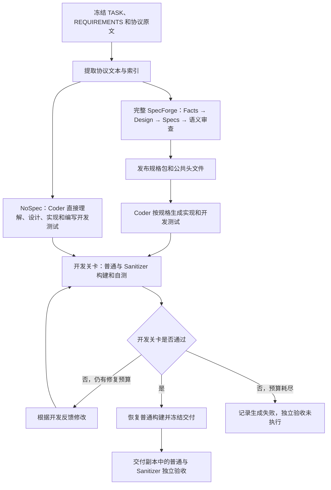

# RQ2 实验设计：显式规格流程消融

设计说明日期：2026-10-12。本文描述当前 MQTT 实验的研究问题、分组、执行流程、计量方法和解释边界，不报告实验结果。

## 1. 研究问题与消融对象

RQ2 考察：**面向实现的显式中间规格及其约束传递流程，如何影响生成实现的独立构建成功、场景通过率、异常与边界场景通过率及完整任务成功。**

比较完整 SpecForge 与 NoSpec-SpecForge。完整系统先提取协议事实、设计模块和接口、生成行为规格、进行规格语义审查，再让 Coder 按已发布规格实现项目；NoSpec 将这些上游阶段整体移除，由 Coder 直接根据任务、需求和协议原文完成理解、设计、实现及开发测试。

消融对象包括 Facts、Design、Specs、规格语义审查、规格回修，以及通过规格包和固定公共头文件向 Coder 传递约束的机制。因此，RQ2 研究的是这条完整机制的作用，不能单独隔离某个规格字段或一次审查的贡献。NoSpec 仍要求规划公共类型、接口、所有权和处理路径，这些工作由 Coder 自行完成，不生成独立的上游设计或行为规格工件。

实现依据：[完整系统控制器](/home/ljf/SpecForge/specforge/pipeline.py)、[RQ2 适配器](/home/ljf/SpecForge/expriments/RQ2/adapter.py)、[NoSpec Coder 提示词](/home/ljf/SpecForge/expriments/RQ2/coder.md)。

## 2. 实验任务与统一输入

当前比较仅使用 MQTT。运行器也支持 CoAP、HTTP/1.1 和 SMTP，但这些协议不进入本次 RQ2 的 MQTT 样本集合。

任务是从头生成一个 Linux TCP 上的独立、多文件 C99 MQTT 3.1.1 broker，使用 GCC 和 Make 构建，交付源码、公共头文件、Makefile、README、开发测试、交付清单及 `mqtt_broker`。运行约定为 `./mqtt_broker <port>`，不导入现有 broker 实现。

每次运行冻结相同的三份输入：

| 输入 | 作用 | 原始文件 |
| --- | --- | --- |
| TASK.md | 项目类型、交付物、构建和启动约定 | [TASK.md](/home/ljf/SpecForge/cases/mqtt_min/TASK.md) |
| REQUIREMENTS.md | R01–R12 的功能、边界和资源要求 | [REQUIREMENTS.md](/home/ljf/SpecForge/cases/mqtt_min/REQUIREMENTS.md) |
| MQTT 3.1.1 原文 | 协议规则来源 | [mqtt-v3.1.1-os.pdf](/home/ljf/SpecForge/cases/mqtt_min/spec/mqtt-v3.1.1-os.pdf) |

需求子集包含匿名 CONNECT、QoS 0 SUBSCRIBE/PUBLISH、精确和 `+`/`#` 主题匹配、二进制及空载荷、TCP 分片与合并帧、EOF 前完整帧处理、PING、断连清理、非法连接隔离及资源释放。QoS 1/2、保留消息、Will、持久会话、UNSUBSCRIBE、认证、TLS 和完整 MQTT 合规不在任务范围内。

输入冻结后提取协议文本、分页文件及索引供读取和搜索。该预处理保留在两条流程中；NoSpec 不用它建立替代事实库或规格包。当前两组的三份输入和 MQTT 独立验收器使用相同 SHA-256，输入内容与评测任务保持一致。

## 3. 实验分组与样本组织

一次从新项目目录开始的 MQTT 生成任务是一个实验样本。开发检查、普通/Sanitizer 验收以及同一任务的中断续接，都不增加生成样本数。

| 分组 | 当前样本集合 | 数据入口 |
| --- | --- | --- |
| 完整 SpecForge | 五次历史 MQTT 任务，round_01–round_05 | [历史数据目录](/home/ljf/SpecForge/runs/paper)、[汇总索引](/home/ljf/SpecForge/runs/paper/summary.json) |
| NoSpec 主实验 | 五次 MQTT 任务，round_01–round_05 | [RQ2 数据目录](/home/ljf/SpecForge/expriments/RQ2/runs/paper)、[汇总索引](/home/ljf/SpecForge/expriments/RQ2/runs/paper/summary.json) |
| NoSpec 补充实验 | 一次单独的 MQTT 试运行，不并入上述五次主实验样本 | [运行记录目录](/home/ljf/SpecForge/expriments/RQ2/runs) |

当前主比较沿用两组各五次的合并样本，保留每次任务的预算和恢复条件。两组的 round 编号用于定位数据，不代表成对匹配；当前分组不是随机对照设计。

NoSpec 五次任务都从新目录开始，不复用前一任务的源码或规格。第一次单独启动，其余四次分两批、每批两次后台并行运行；各任务保存自己的状态、日志和交付目录。命令执行复用现有隔离运行环境，每个命令有独立网络命名空间，网络测试须在同一命令中完成启动、交互和停止。

统一目录中的复制件与其来源目录代表同一个实验，只计一次；来源映射用于追溯，不把目录复制当作新增样本。

## 4. 两条生成流程

完整系统在 Coder 报告规格缺口时还可进入有界的规格回修与重审，再继续实现修复。NoSpec 移除了 `report_spec_gap` 工具和规格回修路径，其反馈修改只作用于自己的项目工件。

| 机制 | 完整 SpecForge | NoSpec-SpecForge |
| --- | --- | --- |
| 上游协议事实、结构和行为规格 | 分阶段生成、检查、审查并发布 | 移除 |
| Coder 的只读行为输入 | 已发布规格包 | TASK、REQUIREMENTS 和协议文本 |
| 公共头文件 | Planner 编写，由控制器复制给 Coder 并设为只读 | Coder 自行编写，可与源码一起修改 |
| 实现、Makefile、README、开发测试 | Coder 生成 | Coder 生成 |
| 交付需求追溯 | 需求编号及规格测试引用 | 保留需求编号，移除 `spec_test_refs` |
| 工具、执行沙箱、检查点和上下文重建 | 使用共享实现 | 复用共享实现 |
| 开发反馈与独立验收 | 开发反馈可用于修复，独立验收在交付后执行 | 相同分离原则 |

NoSpec Coder 可读取、搜索、写入、编辑、执行命令并调用开发检查。WORKLOG 保存进度和下一步操作。共享 agent 在达到检查点条件后从磁盘重建上下文；该机制保留，不能把 NoSpec 描述为取消上下文恢复的单次直接输出。

## 5. 响应预算与停止规则

| 任务预算 | 完整 SpecForge 当前历史样本 | NoSpec 主实验 |
| --- | --- | --- |
| Facts | 40 个模型响应 | 移除 |
| Design | 100 个模型响应 | 移除 |
| Specs 作者任务 | 180 个模型响应 | 移除 |
| 规格语义审查 | 第 1–3 次为 60；第 4 次由 60 扩至 120；第 5 次为 150 | 移除 |
| 首次 Coder | 180 个模型响应 | 300 个模型响应 |
| 实现修复 | 每轮 40 个响应，最多三轮 | 每轮 40 个响应，最多三轮 |
| 规格回修 | 最多一次；回修作者上限 180 个响应，随后按对应审查预算重审 | 移除 |

NoSpec 单任务的模型响应上限为 `300 + 3 × 40 = 420`。开发关卡通过即停止，不要求用满预算。一次模型响应可请求多个工具调用；预算按模型完成响应计数，不按工具数量计数。

首次 Coder 任务内可以多次修改源码和测试。`implementation_repairs` 仅表示额外启动的外层实现修复轮次。截断响应不执行其中的部分工具调用；API 异常保留为失败记录。NoSpec 恢复同一 job 时沿用原响应计数，不重新获得完整预算。

历史预算依据原始请求中的 `Bounded job budget`、预算覆盖记录和续接证据确定，不把当前控制器常量直接套用到旧实验。

## 6. 开发关卡与独立验收

### 6.1 开发关卡

两组均使用普通构建、普通开发自测、ASan+UBSan 构建和对应自测，并恢复普通构建用于交付。检查包含严格编译警告、Sanitizer 插桩及诊断、测试是否保留当前构建的二进制，以及交付文件清单。

NoSpec 的清单检查保留文件存在性、源码和测试登记、测试 ID 唯一性、未知需求编号检查及全部 R01–R12 的编号覆盖。编号覆盖属于结构检查，不能单独证明测试断言覆盖了全部需求语义。提示词要求至少一个开发测试启动真实交付可执行文件并通过网络断言核心交互；库单测不能替代该测试。

开发检查的失败信息反馈给 Coder，作为生成和修复输入。开发关卡通过由控制器判定，模型的完成声明不能覆盖关卡结果。

### 6.2 独立验收

生成完成后冻结交付，在交付副本中使用同一份[MQTT 验收器](/home/ljf/SpecForge/evaluation/mqtt_check.py)执行普通与 ASan+UBSan 两种模式。验收器及其报告不进入 Coder 的生成上下文，也不用于继续调整该任务的实现。

MQTT 使用完整的 16 个必需场景，覆盖客户端间发布订阅、CONNECT/SUBACK 语义、二进制载荷、主题匹配、分片和合并输入、EOF、PING、断连清理、错误隔离及 Mosquitto 互操作。每种模式单独保存场景状态和错误。

完整任务成功要求生成关卡通过，且两种独立验收的所有必需场景均实际执行并通过。构建失败、环境阻塞、缺失报告、跳过或未执行场景都不能记为通过。同一生成项目的两种模式是重复测量，样本量仍是一。

独立验收开始后禁止恢复生成；如重新验收，只对冻结交付再次评测，保留旧报告，不计作新的生成样本。

## 7. 论文评估指标

论文仅使用以下四项指标，依据生成状态及冻结交付的独立验收记录计算：

| 指标 | 计量方法 |
| --- | --- |
| 独立构建成功 | 单次任务的普通与 Sanitizer 独立构建均实际成功时记为成功；组内统计成功任务占全部任务的比例 |
| 场景通过率 | 单次任务两种模式中实际通过的必需场景数 / 两种模式计划执行的必需场景总数，固定分母为 `2 × 16` |
| 异常与边界场景通过率 | 单次任务两种模式中实际通过的异常与边界场景数 / 两种模式计划执行的该子集场景总数，固定分母为 `2 × 10` |
| 完整任务成功 | 单次任务满足第 6.2 节完整成功条件时记为成功；组内统计成功任务占全部任务的比例 |

当前异常与边界子集固定为以下十个完整场景：`mqtt_buffer_before_eof`、`mqtt_disconnect_subscription_cleanup`、`mqtt_malformed_survival`、`mqtt_connect_semantics`、`mqtt_invalid_packet_connection_isolation`、`mqtt_exact_binary_payload`、`mqtt_plus_filter_boundaries`、`mqtt_hash_filter_boundaries`、`mqtt_fragmented_input`、`mqtt_coalesced_input`。它是依据验收器内容定义的分析子集，不是验收报告的原生标签；场景内部多个断言不拆成多个样本。

构建失败、环境阻塞、缺失报告、跳过或未执行的场景均不计为通过，也不从计划分母中删除。普通与 Sanitizer 的场景状态分别保存，合并计算通过率时计数单位为“场景与模式组合”，不增加独立生成样本量。

## 8. 汇总与证据保存

每次任务保存冻结输入及哈希、协议文本、项目、交付清单、阶段状态、jobs、框架/适配器/提示词哈希、原始 request/response/tools、命令日志、开发报告和独立验收报告。后台实验另保存可用的 PID 和控制台日志。

每次任务先计算四项指标，再分别对两组各五次任务求算术均值。独立构建成功和完整任务成功采用成功为 1、未成功为 0 的任务级记录，因此组均值对应成功任务比例。两项场景通过率先按单次任务的固定分母计算，再求组均值；未完成任务仍保留在本组分母中。

复制归档按来源身份去重；同一任务的中断续接或重复验收不增加样本数。历史绝对路径通过当前位置和来源映射定位。原始记录与冻结交付用于审计，分析只读取已有数据。

## 9. 设计的解释边界

当前两组统一了协议任务、输入和独立验收器；首次 Coder 预算、历史语义审查上限、恢复条件和部分框架版本存在差异。这些条件应随实验设计说明，不能将观察到的差异全部归因于规格机制。

四项指标评估的是规定 MQTT 子集在固定验收场景下的构建与行为表现，不能据此推断完整 MQTT 合规或其他协议的表现。开发测试的需求编号覆盖也不能单独证明全部需求语义已被验证。

每组五次 MQTT 任务支持描述性的组间比较；普通与 Sanitizer 测量不能扩大独立样本量。本设计不预设显式规格一定提高上述四项指标。
